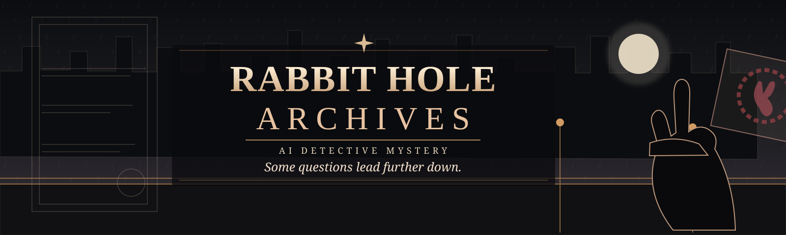

# Rabbit Hole Archives

**Some questions lead further down.**

Rabbit Hole Archives is an AI-narrated detective mystery game built on the [Bunnyland](https://bunnyland.dev/) framework. It is about discovering a truth that already exists, not inventing one as you go.

## Design documentation

- [Visual style guide](docs/design/visual-style-guide.md) — approved direction for color, typography, illustration, evidence presentation, and accessibility.

